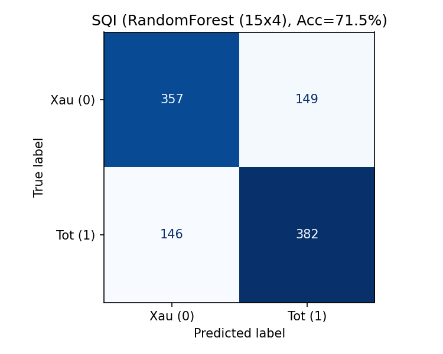

# PPG Motion Artifact Cancellation + SQI on STM32F407

[](firmware/ppg_f407)
[](python)
[](python/ppg_utils.py)
[](python/train_sqi.py)
[](firmware/ppg_f407)
[](#hardware)
[](#evaluation--results)
[](#key-features--tech-stack)

Real-time photoplethysmography (PPG) heart-rate pipeline on a bare-metal STM32F407: acquire IR/Red + 3-axis acceleration at 100 Hz, cancel motion with a 3-channel NLMS adaptive filter, estimate HR, and (offline) classify signal quality with a lightweight model trained under leave-one-subject-out (LOSO) validation.

---

## Overview & Motivation

Wrist PPG is cheap and wearable-friendly, but **motion artifact** routinely destroys heart-rate estimates during walking, stairs, and cycling. Consumer devices hide this with proprietary DSP; many student demos stop at a MAX30102 “pulse plot” with no accelerometer reference, no public-dataset MAE, and no on-device filter.

This project treats that as an engineering problem:

1. Build a **synchronized PPG + IMU** capture chain on STM32 (I2C + UART logging).
2. Implement **Normalized LMS (NLMS)** using 3-axis acceleration as the noise reference — first in Python, then ported to C with FPU floats.
3. Validate HR error against **ECG-derived labels** on PPG-DaLiA (15 subjects) and stress-test the same algorithm on **self-recorded hardware data** (8 subjects × 4 contact/motion conditions).
4. Train a **tiny SQI classifier** (7 features, ~10 s windows) so the device can say “this HR is not trustworthy” instead of always displaying a number.

**Not a medical device.** Academic / research prototype only — not for diagnosis.

---

## Architecture & Workflow

```
MAX30102 (IR/Red @ 100 Hz, I2C 0x57) ──┐
                                        ├─► UART CSV (index,red,ir,ax,ay,az)
MPU6050  (ax,ay,az @ 100 Hz, I2C 0x68) ─┘         │
        │                                         ▼
        │                              Python: fix stale FIFO samples
        ▼                              bandpass 0.5–5 Hz (causal SOS)
STM32 100 Hz loop                      3-ref NLMS (taps=32, μ=0.02)
  EMA DC removal                       spectral HR tracking (±12 bpm)
  2-section biquad BP                  7-D window features → SQI (RF)
  NLMS 96-tap FPU                      │
  peak/HR + OLED IR/HR                 ▼
  (SQI on OLED: in progress)     report/ MAE tables, confusion matrix
```

**On-chip path (`firmware/ppg_f407/Core/Src/`):** `main.c` polls MAX30102 FIFO + MPU6050, streams CSV, and calls `ppg_nlms_step()` in `dsp_nlms.c`. Sampling is a 10 ms SysTick loop; OLED refresh is throttled to 2 Hz (`USE_OLED 0` during logging to reduce I2C jitter).

**Offline path (`python/`):** `read_ppg.py` logs the UART stream → `check_data.py` / `nlms_csv.py` on in-house CSVs → `nlms.py` + `sweep_nlms.py` on PPG-DaLiA → `train_sqi.py` trains Decision Tree / Random Forest / MLP with LOSO.

---

## Demo & Visuals

*Repo currently has numeric reports under `report/` but **no committed PNGs or board photos**. Capture these before sending the GitHub link to a recruiter:*

| Slot | File to add | What to show (one glance) |
|------|-------------|---------------------------|
| 1 | `picture/hw_setup.jpg` | STM32F407 Discovery + MAX30102 + MPU6050 + SSD1306 on the shared I2C bus |
| 2 | `picture/oled_hr.gif` | OLED showing `IR:` / `HR:` and a live IR waveform (~2–3 s loop) |
| 3 | `docs/architecture.png` | The pipeline diagram above, redrawn in draw.io / Excalidraw |
| 4 | `report/nlms_dalia_S3.png` | DaLiA subject with **walking** MAE drop (e.g. 24.0 → 4.9 bpm) |
| 5 | `report/nlms_dalia_S5_stairs.png` | Stairs case with large drop (64.4 → 2.0 bpm) **and** a case where NLMS does not help |
| 6 | `report/nlms_hw_manh.png` | In-house heavy-motion CSV: PPG before/after NLMS + acc magnitude |
| 7 | `report/sqi_confusion.png` | LOSO confusion matrix (script already writes this path) |

Insert them here:

```markdown



```

---

## Key Features & Tech Stack

| Feature | Why this stack |
|---------|----------------|
| **100 Hz PPG + IMU capture** | MAX30102 SpO2 mode (IR+Red) and MPU6050 ±4 g share I2C1 @ 400 kHz; USART2 @ 115200 for PC logging |
| **Causal bandpass 0.5–5 Hz** | 2nd-order Butterworth SOS, same coefficients in SciPy and C biquads — matches real-time chip behavior (`causal=True`) |
| **3-channel NLMS** | Accelerometer as reference; per-axis variance normalize + **soft-normalized** step `μ e / (ε·P̄ + P)` so weights do not explode when the subject is still |
| **HR tracking, not raw FFT argmax** | 8 s windows / 2 s hop, lock within ±12 bpm, relock after 3 misses — reduces harmonic jumps vs ECG labels |
| **FIFO stale-sample repair** | MAX30102 32-deep FIFO can replay old `(red, ir)` pairs; `fix_stale()` interpolates them before DSP |
| **SQI (offline)** | 7 C-portable features, Random Forest 15×depth-4, LOSO by subject — chosen to fit a later on-chip port |
| **Public + private data** | PPG-DaLiA (ECG HR ground truth) + 49 in-house CSVs under `data/mine/` |

**Firmware:** C11, STM32F4 HAL, Cortex-M4 FPU (`fpv4-sp-d16`, hard-float), CubeIDE project (`ppg_f407.ioc`).  
**Python:** NumPy, SciPy, pandas, Matplotlib, scikit-learn, pyserial.

---

## Evaluation & Results

Protocol: bandpass → NLMS (`taps=32`, `mu=0.02`, `eps_rel=1.0` on hardware / SQI training; DaLiA scripts default `taps=16` unless overridden) → spectral HR with tracking. DaLiA labels are ECG-derived HR every 2 s. Transition activity (`activity==0`) is excluded.

### PPG-DaLiA (15 subjects) — tracked HR MAE vs ECG

Unweighted mean of per-subject MAEs from `report/dalia_all_results.txt`:

| | Before NLMS | After NLMS | Δ |
|---|:---:|:---:|:---:|
| **Overall (S1–S15)** | **11.83 bpm** | **11.06 bpm** | **−6.5%** |

NLMS helps most when acceleration is informative. Selected activity windows (same log file):

| Condition | Subject | MAE before | MAE after | Reduction |
|---|:---:|:---:|:---:|:---:|
| Stairs | S1 | 49.6 | 27.2 | −45% |
| Stairs | S5 | 64.4 | 2.0 | −97% |
| Walking | S3 | 24.0 | 4.9 | −80% |
| Cycling | S5 | 80.9 | 34.1 | −58% |
| Walking | S2 | 4.5 | 8.4 | *worse* |

**Takeaway for interviews:** report **overall MAE** first, then activity-specific gains. NLMS is not a free lunch on every subject/activity (e.g. S6 stairs 1.3 → 23.1 bpm). That honesty is a strength, not a weakness.

### In-house hardware (MAX30102 + MPU6050 @ 100 Hz)

| Recording | Motion (mean / peak) | HR before (mean ± std) | HR after |
|---|:---:|:---:|:---:|
| Heavy motion, Hung | 0.530 / 2.263 g | 111.3 ± 24.8 bpm | **60.7 ± 2.6 bpm** |
| Heavy motion, Khiem | 0.255 / 1.870 g | 101.7 ± 9.9 bpm | **68.8 ± 13.9 bpm** |

Residual PPG energy after NLMS: **~39–44%** of pre-NLMS energy on those heavy-motion files. In-house HR has **no simultaneous ECG**; `--ref` is a rest/reference bpm, so treat MAE as indicative.

### SQI — LOSO (8 subjects, 1,034 windows of 10 s)

Labels are **protocol-based**: `dungyen` / `nhe` → Good (1); `epchat` / `manh` → Bad (0). Features: `PI%`, PPG std, IBI std, valid IBI ratio, spectral purity, acc mean g, acc max g.

| Model | Accuracy | Precision | Recall | F1 |
|---|:---:|:---:|:---:|:---:|
| Decision Tree (depth=4) | 67.3% | 0.678 | 0.671 | 0.669 |
| **Random Forest (15×4)** | **71.5%** | **0.715** | **0.715** | **0.715** |
| MLP (16, 8) | 63.1% | 0.636 | 0.632 | 0.629 |

Fill in after you re-run `train_sqi.py` if the dataset grows:

| Metric | Value |
|---|---|
| On-chip NLMS step time | `[Y µs]` @ `[clock] MHz` (measure with DWT CYCCNT) |
| Sample-loop jitter | `[Y ms]` p95 (UART + I2C) |
| Dropped UART samples | `[N]` / session (`read_ppg.py` already counts this) |

---

## Hardware

```
STM32F407VGT6 (Discovery)
├── MAX30102   PPG IR+Red     I2C 0x57  → PB6/PB7 (I2C1)
├── MPU6050    accel ±4 g     I2C 0x68  → PB6/PB7
├── SSD1306    128×64 OLED    I2C 0x3C  → PB6/PB7
└── USART2     115200 8N1     PA2/PA3   → USB-UART
```

Set `USE_OLED` to `0` in `firmware/ppg_f407/Core/Src/main.c` while recording CSVs.

---

## Installation & Usage

### Python environment

```bash
git clone https://github.com/<you>/Do-An-PPG.git
cd Do-An-PPG

python3 -m venv .venv
source .venv/bin/activate          # Windows: .venv\Scripts\activate
pip install -r python/requirements.txt
python3 python/check_env.py
```

### 1) Stream a session from the board

```bash
# Firmware: CubeIDE → open firmware/ppg_f407 → Build → Run (ST-LINK)
# Linux/macOS port is often /dev/ttyUSB0 or /dev/cu.usbserial-*; Windows: COMx
python3 python/read_ppg.py --port /dev/ttyUSB0 --seconds 60 \
  --out data/mine/YourName/ppg_dungyen_lan1_YourName.csv
```

CSV columns: `sample,t_s,red,ir,ax,ay,az` at 100 Hz.

### 2) Quick data-quality report

```bash
python3 python/check_data.py data/mine/Du/ppg_dungyen_lan1_Du.csv
```

### 3) NLMS on an in-house CSV (match firmware: 32 taps, μ=0.02)

```bash
python3 python/nlms_csv.py \
  --csv data/mine/KhiemHungMinh/ppg_manh_lan2_Hung.csv \
  --taps 32 --mu 0.02 --eps 1.0 --ref 60 --out report/nlms_hw_manh.png
```

### 4) PPG-DaLiA (gitignored, ~2.7 GB)

Download [PPG-DaLiA (UCI, CC BY 4.0)](https://archive.ics.uci.edu/dataset/495/ppg+dalia) into `data/public/PPG_FieldStudy/`.

```bash
# Optional: wrist-only .npz (small enough to keep locally)
python3 python/extract_dalia_wrist.py data/public/PPG_FieldStudy data/public_small

python3 python/nlms.py --dalia data/public/PPG_FieldStudy/S1/S1.pkl --taps 32 --mu 0.02 --eps 1.0
python3 python/sweep_nlms.py data/public/PPG_FieldStudy/S1/S1.pkl
```

### 5) Train SQI (auto-discovers `data/mine/**/ppg_*.csv`)

```bash
cd python
python3 train_sqi.py --data-dir ../data/mine \
  --out-csv ../report/sqi_features.csv \
  --out-fig ../report/sqi_confusion.png
```

### 6) Firmware

Open `firmware/ppg_f407` in **STM32CubeIDE** → Build → Run. There is no CMake/Make CLI target yet (CubeIDE `.cproject` only).

HR-only offline plot (no NLMS):

```bash
python3 python/filter_hr.py --csv data/mine/Du/ppg_dungyen_lan1_Du.csv --channel ir
```

---

## Repository layout

```
Do-An-PPG/
├── firmware/ppg_f407/     STM32CubeIDE, HAL, dsp_nlms.c/.h, main.c
├── python/                DSP, NLMS, SQI, UART logger, DaLiA tools
├── data/mine/             In-house CSVs (8 subjects, 4 conditions)
├── data/public/           PPG-DaLiA (gitignored)
├── report/                dalia_all_results.txt, sqi_features.csv
└── picture/               Hardware photos (add before resume links)
```

---

## Future Improvements

1. **On-chip SQI + cycle-accurate DSP budget** — export the depth-4 tree or 15-tree RF to C, print `SQI: GOOD/BAD` on the OLED, and log `ppg_nlms_step()` time with DWT CYCCNT at 168 MHz (PLL from HSE; the board currently runs HSI 16 MHz).
2. **Golden-reference tests** — Python NLMS vs `dsp_nlms.c` on a shared CSV fixture (bit-exact or max abs error &lt; 1e-3) in CI; align default `--taps/--mu` across `nlms.py`, `nlms_csv.py`, and firmware.
3. **Better labels & fusion** — simultaneous ECG or pulse-ox reference for in-house MAE; try NLMS + simple Kalman / harmonic HR tracker; DMA + I2C interrupts instead of a blocking poll/`printf` loop.

---

## Dataset credits & disclaimer

PPG-DaLiA: Reiss, Indlekofer, Schmidt (2019), UCI ML Repository, [DOI 10.24432/C53890](https://archive.ics.uci.edu/dataset/495/ppg+dalia), CC BY 4.0.

Academic project — Biomedical Electronics, 2026. **Not intended for medical diagnosis.**
